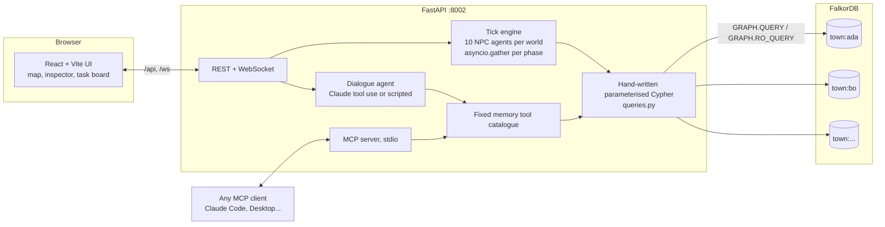
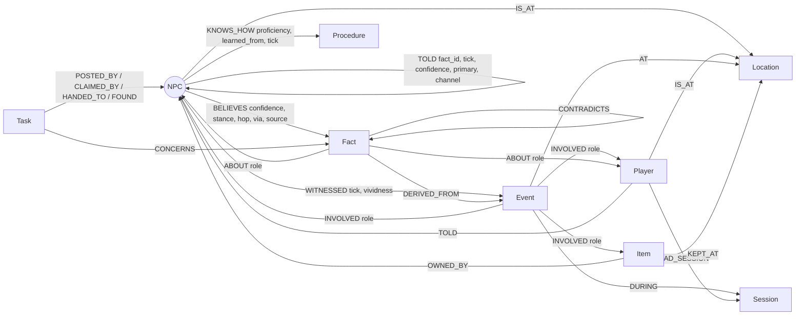

# Living Town

**A graph memory engine for multi-agent systems, shown as a town that gossips.**

**[Live demo](https://living-town.onrender.com)** · **Demo video:** _(link added at submission)_ · **[Every Cypher query](docs/CYPHER.md)** · **[Demo script](docs/DEMO.md)**

Built for **Graph Hacks: Context for AI Agents** (WeMakeDevs x FalkorDB).
**Tracks:** Agent Memory and Coordination (primary) · Agents That Act on Connected Data.

> The live demo runs on Render's free tier: the first visit after ~15 idle minutes takes about a minute to wake up.

<!-- HERO: drop a 1920x1080 screenshot or short GIF at docs/media/hero.gif and uncomment:

-->

## The 30-second version

Ten NPC agents live in Thornbury. Each one's memory is a subgraph in FalkorDB: what they **saw** (episodic), what they **believe and who told them** (semantic, with provenance), and what they **know how to do** (procedural).

You steal the blacksmith's silver hammer. Only the blacksmith sees it. Over the next simulated hours the story travels along social edges in the graph, losing confidence at every hop, until a guard who saw nothing walks up to you the next morning. Ask him *"How do you know?"* and he answers with the exact path the query returned:

```
Ada -[stole]-> (theft) <-[WITNESSED]- Bram -[TOLD]-> Mira -[TOLD]-> Captain Oswin
"I heard it from Mira (day 1, evening, 44% sure); Mira had it from Bram (day 1, midday, 73% sure);
 and Bram saw it with their own eyes at The Forge. Also confirmed by Finn."
```

Ask Sister Agnes the same thing and she says *"Silver hammer? Nothing in my memory connects to that."* No path in the graph means no answer, not a guess.

## Try it in two minutes (live site)

1. Open the [live demo](https://living-town.onrender.com), type a name, press **Enter the town**.
2. Click **The Forge**, then **Steal the silver hammer**.
3. Press **Live through the day** and watch the **Town talk** log: Bram tells Mira, Mira tells Captain Oswin, Oswin posts an investigation, Finn claims it, and at dawn Oswin confronts you.
4. Open **Captain Oswin's memory** and press **Why do you believe that?** A red thread draws the provenance path across the map.
5. Press **Two players side by side**: the second player's world is a separate graph where nobody has heard of any hammer.

## How it covers the tracks

**Agent Memory and Coordination**

| The track asks for | Where it lives in the graph | See it in the app |
|---|---|---|
| Episodic memory | `(:NPC)-[:WITNESSED]->(:Event)-[:AT]->(:Location)` | Bram's memory: the theft he saw, with time and place |
| Semantic memory | `(:NPC)-[:BELIEVES {confidence, stance, hop, via}]->(:Fact)` | Oswin accepts the story at 44%; Rowan doubts it at 19% |
| Procedural memory | `(:NPC)-[:KNOWS_HOW {proficiency, learned_from}]->(:Procedure)` | Only Finn knows how to investigate; NPCs teach each other skills |
| Persistent history across sessions | `(:Player)-[:HAD_SESSION]->(:Session)<-[:DURING]-(:Event)` | Return under the same name and townsfolk greet you from memory |
| Shared state and handoffs | `(:Task)` with `POSTED_BY`, `CLAIMED_BY`, `HANDED_TO`, `FOUND` | Oswin posts, Finn claims atomically, findings are handed back |
| High-concurrency reads and writes | all 10 agents run each tick phase concurrently against one graph | **Graph insights > Run the stress test**: 40 agents in 4 worlds, writes per second |
| Separate memory per user or tenant | one FalkorDB graph per player: `town:{player_id}` | **Two players side by side** |

**Agents That Act on Connected Data**

| The track asks for | In Living Town |
|---|---|
| Multi-hop reasoning | provenance is a variable-length `TOLD*` path back to the eyewitness |
| Graph algorithms as tools | label propagation (cliques), betweenness (gossip brokers), PageRank (best informed), SSpaths (who hears next), WCC, BFS, harmonic centrality |
| Tool selection through MCP | 19 memory tools exposed over MCP; Claude or any MCP client picks tools and arguments, never writes Cypher |
| Actions based on graph results | the guard investigates and confronts *because* the provenance path exists; witnesses who know `report_crime` walk to the guard |
| Explainable results | every answer returns the path that produced it |

## Why the graph does the work

Graphiti, Mem0 and Cognee give *one* agent a memory. Living Town is about memory that is **socially distributed** across many agents, and every interesting answer is a graph traversal:

| | Typical agent memory | Living Town |
|---|---|---|
| Where knowledge lives | one store per agent | one graph; each agent's memory is its neighbourhood |
| How knowledge moves | copied | travels along `KNOWS` edges as `TOLD` edges, one hop at a time |
| Provenance | a source field | a queryable path back to the eyewitness, returned to the user |
| Certainty | static | decays per hop (listener trust x 0.9) and overnight |
| Conflicts | last write wins | contradicting claims coexist; the trust-weighted one is accepted, the other doubted |
| Coordination | message passing | shared task board in the graph with atomic claims and handoffs |
| Tenancy | filter on a column | one FalkorDB graph per player: `town:{player_id}` |

- "How do you know?" is a variable-length path query, and the path *is* the explanation.
- "Who hears it next?" is a weighted shortest-path algorithm over social distance.
- Cliques come from label propagation; the gossip broker comes from betweenness.
- Bram never talks to the captain (affinity 0.1), so the story *has* to route through Mira. That routing only exists in the graph.

## What you can do

- **Act:** walk, steal, give, help, trade, spread a rumour (lie), talk.
- **Watch:** NPCs follow daily schedules; each tick all 10 agents run concurrently, perceive who is nearby, and pass on their most salient belief. Gossip shows as sparks travelling between avatars.
- **Ask why:** open any NPC's memory, press *Why do you believe that?* and a red thread draws the provenance path across the map.
- **Coordinate:** the guard posts an investigation on a shared task board; the deputy (the only agent who `KNOWS_HOW` to investigate) claims it atomically, traces the story to its eyewitness, takes testimony and hands findings back.
- **Lie:** tell Mira that Pip stole the hammer. If she already believes otherwise with more confidence, she catches the lie and *that* becomes a story about you.
- **Return:** come back under the same name in a new session and the townsfolk greet you from persistent memory.
- **Compare tenants:** *Two players side by side* shows two isolated worlds; a crime in one never leaks to the other.

## Architecture



Each tick runs seven phases; inside every phase all agents run concurrently against the same graph:
`move` (schedule, or a task: report / investigate / confront) then `gossip` then `post` tasks then `claim` (races settled by the database) then `work` then `teach` then `notice` unseen thefts. A tick is 23-42 graph queries in about 6 sequential round trips (independent reads and writes run concurrently): roughly 160 ms against FalkorDB Cloud from a laptop and 260-400 ms on the live site.

## Graph data model

One graph per player: `town:{player_id}`.



| Memory kind | Nodes and edges | Example question it answers |
|---|---|---|
| Episodic | `(:NPC)-[:WITNESSED]->(:Event)-[:AT]->(:Location)`, `(:Event)-[:INVOLVED]->(...)` | What did Bram see at the Forge? |
| Semantic | `(:NPC)-[:BELIEVES {confidence, stance, hop, via}]->(:Fact)-[:ABOUT]->(entity)` | What does Oswin believe about Ada, and how sure is he? |
| Provenance | `(:NPC)-[:TOLD {fact_id, primary}]->(:NPC)`; each believer has exactly one primary in-edge per fact, so the chain is a tree | Who told Oswin, and who told them? |
| Conflict | `(:Fact)-[:CONTRADICTS]->(:Fact)`, `BELIEVES.stance` = accepted / doubted | Which version does Mira accept? |
| Procedural | `(:NPC)-[:KNOWS_HOW {proficiency, learned_from}]->(:Procedure {steps})` | Who can investigate? Who taught Hilda? |
| Social | `(:NPC)-[:KNOWS {trust, affinity, bond, distance}]->(:NPC)`, `CLOSE` for affinity >= 0.55 | Whom does Bram tell first? Who never tells the captain anything? |
| Coordination | `(:Task {kind, status})` with `POSTED_BY`, `CLAIMED_BY`, `HANDED_TO`, `FOUND`, `CONCERNS` | Is anyone already investigating this? |
| Sessions | `(:Player)-[:HAD_SESSION]->(:Session)<-[:DURING]-(:Event)` | What happened last time this player visited? |
| Reputation | derived: `sum(Fact.valence * BELIEVES.confidence)` over accepted beliefs about the player | Is Oswin wary of Ada? |

Rules the engine applies:
- A witness believes with confidence 1.0. A listener's confidence is `speaker confidence x listener's trust in speaker x 0.9`; below 0.3 the story is *doubted* rather than accepted.
- Repeating a story to someone who already holds it corroborates it (`corroborations`, confidence rises) instead of creating a second chain.
- Hearsay decays by 7% every dawn and fades below 0.12; eyewitness memory keeps its confidence but loses vividness.
- Guards keep open cases confidential; Bram never tells the captain anything (affinity 0.1), which is why the story has to route through Mira.

## Cypher queries and graph algorithms

The product runs only hand-written, parameterised queries from `backend/app/queries.py` (108 of them: 50 reads, 50 writes, 8 algorithm calls). Agents, Claude and MCP clients pick a query and arguments; none of them writes Cypher. Reads use `ro_query`. The full list with every Cypher statement is generated into [docs/CYPHER.md](docs/CYPHER.md) (`uv run python -m app.catalogue`).

Graph algorithms (FalkorDB procedures) the product depends on:

| Query | Procedure | Used for |
|---|---|---|
| `communities` | `algo.labelPropagation` over `CLOSE` | social cliques shown on the map |
| `gossip_hubs` | `algo.betweenness` over `KNOWS` | which agents broker gossip between cliques |
| `best_informed` | `algo.pageRank('NPC','TOLD')` | who receives the most stories |
| `broadcast_reach` | `algo.HarmonicCentrality` over `CLOSE` | who can reach everyone fastest |
| `rumour_islands` | `algo.WCC` over `TOLD` | disconnected rumour clusters |
| `forecast_spread` | `algo.SSpaths` over `KNOWS.distance` | who is likely to hear a story next (dashed rings on the map) |
| `social_route` | `algo.SPpaths` over `KNOWS.distance` | cheapest social route between two agents |
| `reach_within` | `algo.BFS` over `CLOSE` | who an agent can reach in N hops |
| `resolve_entity` | `db.idx.fulltext.queryNodes` (prefix and fuzzy) | resolve "the blaksmith" or "hamer" to graph entities before any tool call |

Key Cypher (abridged; see docs/CYPHER.md):

```cypher
// tell: the gossip handoff (one atomic statement)
MATCH (a:NPC {id:$from})-[:BELIEVES]->(f:Fact {id:$fid}), (b:NPC {id:$to})
MERGE (b)-[bel:BELIEVES]->(f)
  ON CREATE SET bel.confidence=$conf, bel.stance = CASE WHEN $conf >= $accept THEN 'accepted' ELSE 'doubted' END,
                bel.hop=$hop, bel.via=$from, bel.since_tick=$tick, bel.source='told'
  ON MATCH SET bel.corroborations = coalesce(bel.corroborations, 0) + 1, ...
MERGE (a)-[t:TOLD {fact_id:$fid}]->(b)
SET t.primary = coalesce(t.primary, false) OR coalesce(bel.via = $from, false)

// who_told_me: provenance path back to the eyewitness
MATCH (me:NPC {id:$npc})-[b:BELIEVES]->(f:Fact {id:$fid})
OPTIONAL MATCH chain = (src)-[:TOLD*0..10]->(me)
  WHERE all(r IN relationships(chain) WHERE r.fact_id = $fid AND r.primary = true)
WITH me, b, f, chain ORDER BY length(chain) DESC LIMIT 1
OPTIONAL MATCH (nodes(chain)[0])-[w:WITNESSED]->(e:Event)<-[:DERIVED_FROM]-(f) ...

// claim_task: only one agent can win, and only if it knows the procedure
MATCH (t:Task {id:$tid}) WHERE t.status = 'open'
MATCH (n:NPC {id:$npc})-[:KNOWS_HOW]->(p:Procedure) WHERE p.id = t.required
SET t.status = 'claimed', t.claimed_by = $npc CREATE (t)-[:CLAIMED_BY]->(n)

// forecast_spread: who hears next
MATCH (b:NPC)-[bel:BELIEVES]->(f:Fact {id:$fid}) WHERE bel.stance = 'accepted'
CALL algo.SSpaths({sourceNode:b, relTypes:['KNOWS'], weightProp:'distance', maxLen:3, pathCount:40})
YIELD path, pathWeight ...
```

## Agents and the LLM

- **Without `ANTHROPIC_API_KEY` (the default):** everything runs in deterministic *scripted* mode. Agent decisions are rule-based (seeded per tick and agent), and dialogue is templated from the rows the memory tools return. The demo never depends on a key; the UI shows *Scripted agents*.
- **With a key:** NPC dialogue uses Claude (`claude-opus-5-5` by default, `LLM_MODEL` to override) through the official `anthropic` SDK with tool use over the fixed catalogue: `resolve_entity`, `recall_about`, `who_told_me`, `what_happened_at`, `my_relationships`, `my_procedures`, `my_tasks`, `opinion_of_player`, `record_memory`. Adaptive thinking, `effort` from `LLM_EFFORT` (default `low` for chat latency), no forced `tool_choice`, `stop_reason` checked (refusal, pause_turn, max_tokens), and server-side refusal fallbacks (`fallbacks: "default"`).
- **Output validation:** every person, item and place the model names must appear in that turn's tool results; otherwise the reply is discarded and the templated, memory-grounded answer is shown instead (the UI says so).
- Tick decisions stay rule-based even with a key, so a tick of 10 agents costs no tokens and stays fast.

## MCP server

The same memory tools are exposed over MCP (Python MCP SDK v2 `MCPServer`, the successor of FastMCP, stdio transport): `create_world`, `list_npcs`, `resolve_entity`, `recall_about`, `who_told_me`, `what_happened_at`, `my_relationships`, `my_procedures`, `record_memory`, `tell`, `who_knows`, `forecast_spread`, `task_board`, `post_task`, `claim_task`, `complete_task`, `town_analytics`, `talk_to`, `advance`. Every tool takes `player_id`, so a client only ever touches one tenant graph.

Claude Code:

```bash
claude mcp add living-town -- uv run --directory /path/to/living-town/backend python -m app.mcp_server
```

Claude Desktop or any MCP client (`claude_desktop_config.json`):

```json
{
  "mcpServers": {
    "living-town": {
      "command": "uv",
      "args": ["run", "--directory", "/path/to/living-town/backend", "python", "-m", "app.mcp_server"],
      "env": { "FALKORDB_HOST": "localhost", "FALKORDB_PORT": "6381" }
    }
  }
}
```

Then ask, for example: *"In player ada's town, how does Captain Oswin know about the hammer?"*

## Setup

Requirements: Docker, Python 3.12 with [uv](https://docs.astral.sh/uv/), Node 20+.

```bash
git clone https://github.com/thedevkansal/living-town && cd living-town
cp .env.example .env                      # optional: ANTHROPIC_API_KEY, FalkorDB Cloud credentials

docker compose up -d                      # FalkorDB on localhost:6381, FalkorDB Browser on http://localhost:3001

cd backend
uv sync
uv run uvicorn app.main:app --port 8002   # API + WebSocket on http://localhost:8002

cd ../frontend
npm install
npm run dev                               # UI on http://localhost:5174 (proxies /api and /ws to :8002)
```

Tests (against the live FalkorDB on 6381; each test creates and drops its own `town:test-*` graph):

```bash
cd backend && uv run pytest -q
```

Full stack in containers (UI served by the backend): `docker compose --profile app up -d --build`, then open http://localhost:8002.

### Configuration

| Variable | Default | Meaning |
|---|---|---|
| `FALKORDB_HOST` / `FALKORDB_PORT` | `localhost` / `6381` | FalkorDB endpoint |
| `FALKORDB_USERNAME` / `FALKORDB_PASSWORD` | unset | credentials (FalkorDB Cloud) |
| `FALKORDB_TLS` | `false` | TLS to FalkorDB |
| `MAX_WORLDS` | `20` | keep at most this many player graphs; the least recently active are deleted (keeps a free-tier instance small; a world is roughly 120 nodes and 300 edges) |
| `DEMO_PLAYER` | `demo` | world that is never pruned (join with the name `demo` to use it) |
| `DEMO_AUTOCREATE` | `false` | create the demo world at startup if missing |
| `ANTHROPIC_API_KEY` | unset | enables Claude dialogue |
| `LLM_MODEL` / `LLM_EFFORT` | `claude-opus-5-5` / `low` | model and effort for dialogue |
| `LLM_DISABLED` | `false` | force scripted mode |

## Deploy


The root `Dockerfile` builds the React UI and serves it from FastAPI on `$PORT`
(UI at `/`, API at `/api`). `render.yaml` is a Render Blueprint: **New > Blueprint >
this repo**, then fill `FALKORDB_HOST`, `FALKORDB_PORT`, `FALKORDB_USERNAME`,
`FALKORDB_PASSWORD` (and optionally `ANTHROPIC_API_KEY`). Any Docker host works the same way:

```bash
docker build -t living-town .
docker run --env-file .env -e PORT=10000 -p 10000:10000 living-town
```

Free-tier note: on startup the backend prunes the least recently active `town:*` worlds beyond `MAX_WORLDS`, and it starts even if FalkorDB is briefly unreachable.

<details>
<summary><b>HTTP API</b></summary>


| Method | Path | |
|---|---|---|
| POST | `/api/worlds` `{player_id, name, reset}` | create or rejoin a world, start a session, get greetings |
| POST | `/api/worlds/{pid}/act` `{action, npc, item, location, subject, message}` | move, steal, gift, help, trade, lie, talk |
| POST | `/api/worlds/{pid}/tick?n=1` and `/advance-day?delay=` | run ticks (events also streamed) |
| POST | `/api/worlds/{pid}/autoplay` `{on, interval}` | server-side auto-play |
| POST | `/api/worlds/{pid}/npcs/{npc}/talk` `{message}` | dialogue |
| GET | `/api/worlds/{pid}/npcs/{npc}/memory` | memory subgraph for the inspector |
| GET | `/api/worlds/{pid}/provenance?npc=&fact=` | provenance path, who knows, forecast |
| GET | `/api/worlds/{pid}/analytics` | graph algorithms |
| POST | `/api/bench` `{tenants, ticks}` | concurrency stress test across isolated worlds |
| WS | `/ws/{pid}` | live tick and action events |

</details>

## Data

All characters, places and events are synthetic and invented for this project. No external or personal data is used.

## Known limitations

- **Scripted by default.** Without an `ANTHROPIC_API_KEY` (the live demo has none), NPC decisions and dialogue are rule-based and templated from memory rows. That is deliberate: the memory, gossip and coordination are the product, and they behave the same with or without a model.
- **Live latency.** The app runs in Singapore and FalkorDB Cloud in Mumbai, so every graph query is a cross-region round trip. Ticks batch their queries to stay at 260-400 ms, and a full simulated day plays in about 10 seconds.
- **Free tiers.** Render sleeps after ~15 idle minutes; a scheduled keep-alive pings the app (and through it the database) to keep both awake during judging.

## AI assistance disclosure

Built with Claude Code (Anthropic) as a coding assistant, per hackathon rule 11: it wrote most of the code, tests and this README under the author's direction. The running product optionally uses Claude (via the Anthropic API) for NPC dialogue; without an API key it runs fully in scripted mode.
